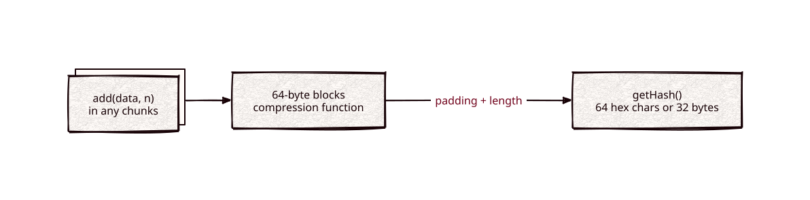

# sha256

Part of [Kronuz C++ Libraries](https://github.com/Kronuz/cpp-libraries), a collection of small, reusable C++ libraries.

[](https://github.com/Kronuz/sha256/actions/workflows/ci.yml)
[](LICENSE)


SHA-256 for C++20: hash a buffer in one call or stream it in chunks, and get 64
hex characters or the raw 32 bytes. Blocks run on the CPU's SHA instructions
(SHA-NI on x86_64, the SHA2 extension on arm64) when it has them, picked at run
time, and on portable C++ otherwise. For content addressing, deduplication, and
integrity checks.



## ✨ Highlights

- **One call or streaming.** `kronuz::sha256::digest("abc")`, or `update()` chunks
  and `final()`; the original `SHA256` class (`add()`, `getHash()`) is unchanged.
- **Hardware speed, one binary.** SHA-NI and ARMv8 kernels are detected once at
  first use; on the CI runners below they run within 1% of OpenSSL EVP on bulk
  data (6% behind with GCC on Neoverse-N2) and ahead of it on 64-byte messages.
- **No clash with OpenSSL.** The namespaced API compiles next to `<openssl/sha.h>`,
  whose global `SHA256()` hides the class of the same name.
- **Hex or raw.** 64 lowercase hex characters, or 32 bytes into your buffer.
- **Any input.** Size-based, so embedded NULs count; buffers at any alignment are
  read safely.
- **Repeatable reads.** `getHash()` finalizes a copy, so you can keep adding.
- **Checked** for every kernel the host has: NIST vectors, every split point,
  random inputs against the portable kernel, unaligned offsets under ASan and
  UBSan, and a libFuzzer target.

## 📦 Installation

Requires a C++20 compiler and CMake 3.14 or newer; it fetches
[endian](https://github.com/Kronuz/endian) and compiles three source files.
`-DSHA256_HARDWARE=OFF` builds the portable kernel alone. CI builds
it on Linux (x86_64, arm64), macOS (arm64, x86_64), and FreeBSD, plus ASan,
UBSan, and TSan builds.

```cmake
include(FetchContent)
FetchContent_Declare(sha256
  GIT_REPOSITORY https://github.com/Kronuz/sha256.git
  GIT_TAG        main)
FetchContent_MakeAvailable(sha256)

target_link_libraries(my_app PRIVATE sha256::sha256)
```

## 🚀 Quick start

```cpp
#include "sha256.h"

#include <cstdio>

int main() {
	namespace sha = kronuz::sha256;
	std::puts(sha::to_hex(sha::digest("abc")).c_str());
	// ba7816bf8f01cfea414140de5dae2223b00361a396177a9cb410ff61f20015ad

	sha::hasher h;
	h.update("hello, ");
	h.update("world");
	std::puts(sha::to_hex(h.final()).c_str());   // same as hashing "hello, world" at once
	std::puts(sha::kernel_name(sha::active_kernel()));   // "sha-ni", "armv8" or "portable"

	SHA256 sha256;                           // the original class, same digests
	std::puts(sha256(std::string_view("abc")).c_str());
}
```

[`examples/demo.cc`](examples/demo.cc) shows the avalanche from a one-byte change.

## 🎯 When to use it

- ✅ Fingerprints of content: cache keys, deduplication, checksums of stored
  data.
- ❌ Passwords, signatures, or MACs: use a reviewed cryptography library (with
  HMAC or a password hash); this implementation is not hardened against side
  channels.
- ✅ Bulk hashing (segments, files) without linking OpenSSL, on CPUs with SHA
  instructions.
- ❌ Bulk hashing on x86_64 without SHA-NI (Intel cores before Ice Lake; every AMD Zen has it): the portable
  kernel is about 2.2× slower than OpenSSL's vectorized assembly there.

## ⚡ Performance

GB/s (1e9 bytes/s), one thread, best of five, from `sha256_bench` against OpenSSL
EVP (`EVP_DigestInit_ex`/`Update`/`Final_ex` on a reused context). 64 B and 4 KiB
are one-shot digests of a cache-hot message, so they include padding and the final
block; 64 MiB is one digest. GitHub's runners are shared VMs, so treat a few
percent as noise; EVP in the same run is the reference.

| Host (compiler, OpenSSL) | Implementation | 64 B | 4 KiB | 64 MiB |
|---|---|---:|---:|---:|
| AMD EPYC 9V74, linux-x86_64 runner (GCC 13.3, 3.0.13) | portable | 0.125 | 0.266 | 0.274 |
| | **sha-ni** | **0.474** | **1.369** | **1.409** |
| | openssl evp | 0.417 | 1.360 | 1.407 |
| Intel Xeon Platinum 8370C, linux-x86_64 runner (GCC 13.3, 3.0.13) | portable | 0.102 | 0.217 | 0.221 |
| | **sha-ni** | **0.454** | **1.304** | **1.314** |
| | openssl evp | 0.382 | 1.279 | 1.307 |
| Neoverse-N2, linux-arm64 runner (Clang 18.1, 3.0.13) | portable | 0.195 | 0.401 | 0.408 |
| | **armv8** | **1.090** | **2.138** | **2.166** |
| | openssl evp | 0.464 | 2.055 | 2.165 |
| Neoverse-N2, linux-arm64 runner (GCC 13.3, 3.0.13) | portable | 0.179 | 0.380 | 0.387 |
| | **armv8** | **0.755** | **1.996** | **2.043** |
| | openssl evp | 0.464 | 2.054 | 2.163 |
| Apple M1 (Virtual), macos-arm64 runner (Apple clang 17, 3.6.4) | portable | 0.135 | 0.266 | 0.277 |
| | **armv8** | **1.167** | **2.244** | **2.263** |
| | openssl evp | 0.926 | 2.192 | 2.284 |
| Intel Core i7-8700B, macos-x86_64 runner, no SHA-NI (Apple clang 17, 3.6.3) | portable | 0.083 | 0.227 | 0.238 |
| | openssl evp | 0.125 | 0.492 | 0.498 |
| Intel Core i9-9980HK, MacBook Pro, no SHA-NI (Apple clang 17, 4.0.3) | portable | 0.114 | 0.240 | 0.242 |
| | openssl evp | 0.200 | 0.526 | 0.536 |

On SHA-NI and ARMv8 cores the hardware kernel is 5.1× to 8.2× faster than the
portable one on 64 MiB and within 1% of EVP there (GCC on Neoverse-N2: EVP 1.06×
faster), and 1.1× to 2.3× faster than EVP on 64-byte messages, where EVP's
per-call overhead dominates. Without SHA instructions EVP's vectorized assembly is
2.1× to 2.2× faster than the portable kernel. Rerun it with:

```sh
cmake -B build -DCMAKE_BUILD_TYPE=Release -DSHA256_BUILD_BENCHMARKS=ON
cmake --build build && ./build/sha256_bench
```

With several OpenSSLs installed (Homebrew's `openssl@3` and `openssl@4`), set
`OPENSSL_ROOT_DIR` so the headers and the library come from the same one; the
bench prints the header's version.

CI's `bench-*` jobs print the same table, with the runner's CPU, on every manual run.
The runner figures above come from run 39356786780 (commit 681593b) and, for the
Xeon row, run 39356305207 (commit 15ac8f3, the same x86 kernel).

## 📚 Documentation

- [docs/API.md](docs/API.md): the `SHA256` class and `kronuz::sha256`.
- [ARCHITECTURE.md](ARCHITECTURE.md): buffering, the kernels and their dispatch,
  and finalization.
- [AGENTS.md](AGENTS.md): repository map and invariants.

## 🛠️ Building and testing

```sh
cmake -B build && cmake --build build && ctest --test-dir build
./build/sha256_demo
cmake -B build -DSHA256_FUZZ=ON -DCMAKE_CXX_COMPILER=clang++ && ./build/sha256_fuzz -max_total_time=60
```

`ctest` runs `sha256` (the class), `sha256_kernels` (every kernel the host has,
plus the forced portable fallback) and, when CMake finds OpenSSL, `sha256_openssl`
(both headers in one file, digests against OpenSSL's `SHA256()`); a host without SHA instructions tests the
portable kernel only, and CI covers SHA-NI and ARMv8.

## 🤝 Contributing

Issues and pull requests are welcome. Read [AGENTS.md](AGENTS.md) first. CI must
pass on every platform.

## 📄 License

MIT, Copyright (c) 2015-2018 Dubalu LLC; portions Copyright (c) 2014, 2015 Stephan
Brumme. See [LICENSE](LICENSE). Extracted from
[Xapiand](https://github.com/Kronuz/Xapiand).
